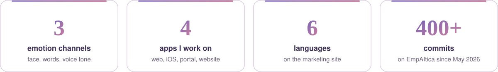

<picture>
  <source media="(prefers-color-scheme: dark)" srcset="assets/banner-dark.svg">
  
</picture>

 

  
  
  

### About me

I'm a software engineer in Stuttgart. I build applications that run in real time and handle sensitive data: voice conversations, emotion signals, clinical records. I work across the whole stack, from a model running on the user's device to the API, the web client and the mobile app.

<picture>
  <source media="(prefers-color-scheme: dark)" srcset="assets/highlights-dark.svg">
  
</picture>

### Now: EmpAItica at ACTIMI

Engineering thesis at **ACTIMI GmbH** in Stuttgart. **EmpAItica** is an AI application that helps detect depression early and follow patients between consultations. The patient talks with a 3D avatar and answers the PHQ-8 questionnaire by voice. The clinician sees the scores and their trend in a dedicated portal.

<picture>
  <source media="(prefers-color-scheme: dark)" srcset="assets/flow-dark.svg">
  
</picture>

- **Emotion from three channels.** Face analysis on the device with MediaPipe and ONNX Runtime, a bilingual English and German word lexicon, and a voice tone model (emotion2vec+) served by a FastAPI service.
- **A stable signal.** Smoothing and fusion of the three readings, so the emotion shown to the patient stays steady instead of flickering.
- **Real-time conversation.** Voice-to-voice dialogue over WebSocket, with a 3D avatar built in three.js.
- **Clinical data.** HL7 FHIR R4 resources and a crisis path that no setting can turn off.
- **The apps around it.** React web client, iOS app with Expo and React Native on TestFlight, clinician portal with online video consultations, administration, and a marketing site in six languages.
- **Privacy by design.** Face analysis stays on the device. No camera image is sent to the server.

The code belongs to ACTIMI and stays private. Live product: [empaitica.com](https://www.empaitica.com)

### Tech stack

| Area | Technologies |
|---|---|
| **Languages** |     |
| **Frontend** |       |
| **Backend** |     |
| **AI** |     |
| **Data and tools** |       |
| **Health and compliance** |   |

### Experience and education

| When | What and where |
|---|---|
| **2026** | Software engineer, engineering thesis · **ACTIMI GmbH**, Stuttgart |
| **2025** | Data and BI intern · **Hewlett-Packard**, Tunisia |
| **2025** | Exchange semester · **Philipps-Universität Marburg**, Germany |
| **2023, 2024** | Software development intern · **ESPRIT**, Tunisia |
| **2022 to 2026** | Master's degree in computer engineering · **ESPRIT**, Tunis |

### Languages

Arabic (native) · French (B2) · English (B2) · German (A2)

<i>Thanks for visiting. Feel free to reach out on LinkedIn.</i>

